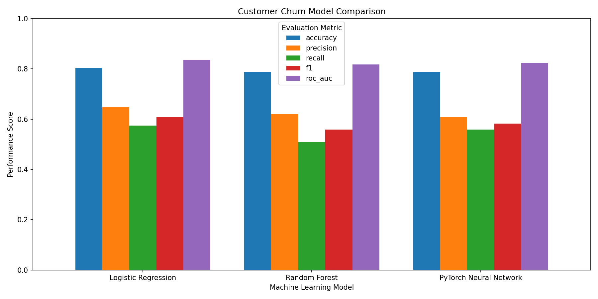

# Customer Churn Prediction and Model Comparison

## Overview

This project is a machine learning classification project built with Python, scikit-learn, and PyTorch. It predicts whether telecommunications customers will churn and compares three different machine learning models.

The project demonstrates an end-to-end machine learning workflow:
1. Load and clean customer data using pandas.
2. Encode categorical features and scale numerical inputs.
3. Split the dataset into training and testing sets.
4. Train Logistic Regression and Random Forest classifiers using scikit-learn.
5. Build and train a custom feedforward neural network using PyTorch.
6. Evaluate all three models using accuracy, precision, recall, F1-score, and ROC-AUC.
7. Compare model performance and explore customer churn patterns through visualizations.

## Tech Stack

- Language: Python 3
- Data Processing: pandas, NumPy
- Machine Learning: scikit-learn
- Deep Learning: PyTorch
- Data Visualization: Matplotlib
- Exploratory Data Analysis: Jupyter Notebook
- Tools: Git/GitHub, Bash/Git Bash, virtualenv, VS Code

## Project Structure

```text
customer_churn_prediction/
├── data/
│   └── customer_churn.csv           # Telco Customer Churn dataset
├── notebooks/
│   └── churn_analysis.ipynb         # Exploratory data analysis
├── results/
│   ├── sklearn_results.json         # Logistic Regression and Random Forest metrics
│   ├── pytorch_metrics.json         # Neural network metrics
│   ├── model_comparison.csv         # Combined model evaluation results
│   └── model_comparison.png         # Model performance visualization
├── src/
│   ├── __init__.py
│   ├── preprocess.py                # Data cleaning, encoding, and scaling
│   ├── train_sklearn.py             # Train and evaluate scikit-learn models
│   ├── train_pytorch.py             # Train and evaluate neural network
│   ├── compare_models.py            # Generate model comparison and chart
│   └── models/
│       ├── __init__.py
│       └── pytorch_model.py         # PyTorch neural network architecture
├── requirements.txt                 # Python dependencies
├── .gitignore
└── README.md
```

## Dataset

- Source: [Telco Customer Churn — Kaggle](https://www.kaggle.com/datasets/blastchar/telco-customer-churn)
- Records: Approximately 7,043 customers
- Target Variable: Churn (0 = No, 1 = Yes)
- Training / Testing Split: 80% / 20%, stratified

The dataset contains information about customer demographics, contract types, tenure, monthly charges, and subscribed services.

## Running Locally

1. Clone the repository and navigate to the project folder:
```bash
git clone <YOUR_REPOSITORY_URL>
cd customer_churn_prediction
```

2. Create and activate a virtual environment:
```bash
python -m venv venv
source venv/Scripts/activate
```

3. Install dependencies:
```bash
pip install -r requirements.txt
```

4. Download the dataset from Kaggle and save it as `data/customer_churn.csv`.

5. Run data preprocessing:
```bash
python -m src.preprocess
```

6. Train Logistic Regression and Random Forest:
```bash
python -m src.train_sklearn
```

7. Train the PyTorch neural network:
```bash
python -m src.train_pytorch
```

8. Generate model comparison results and visualization:
```bash
python -m src.compare_models
```

9. Launch Jupyter Notebook for exploratory data analysis:
```bash
jupyter notebook
```
Open `notebooks/churn_analysis.ipynb`.

## Results and Findings

All three models are evaluated using accuracy, precision, recall, F1-score, and ROC-AUC.

The `results/` directory contains the evaluation metrics in JSON and CSV formats, along with a visualization comparing model performance.



### Exploratory Data Analysis Findings

- Churn Distribution: 26.54% of customers churned, while 73.46% remained.
- Contract Type: Month-to-month customers had the highest churn rate (42.71%), compared with one-year (11.27%) and two-year (2.83%) contracts.
- Customer Tenure: Churned customers averaged 17.98 months of tenure, compared with 37.57 months for retained customers.
- Monthly Charges: Churned customers paid an average of $74.44 per month, compared with $61.27 for retained customers.

These findings show associations between customer churn, contract type, tenure, and monthly charges.
